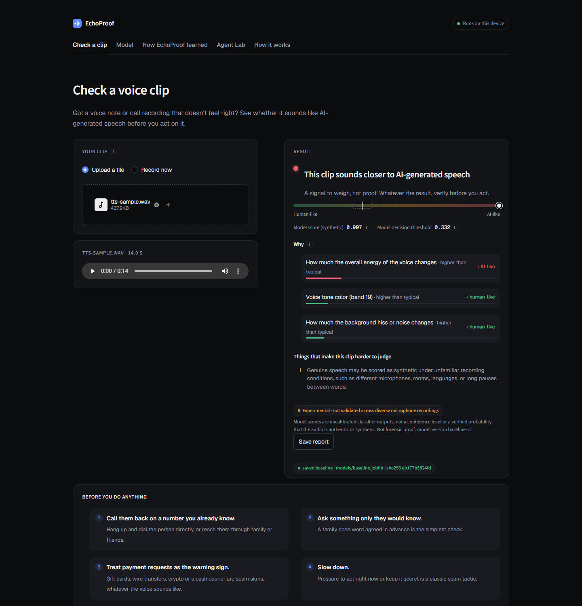
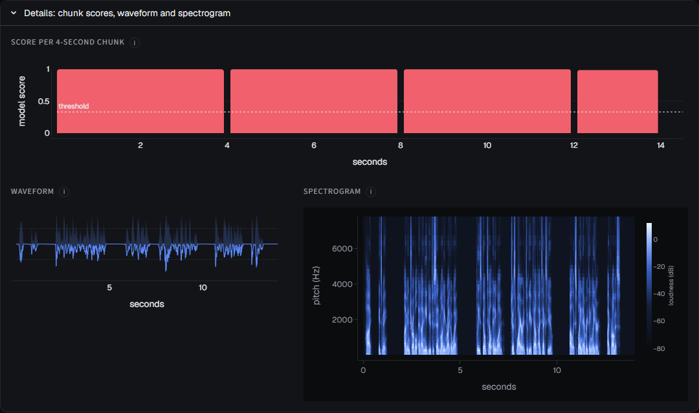
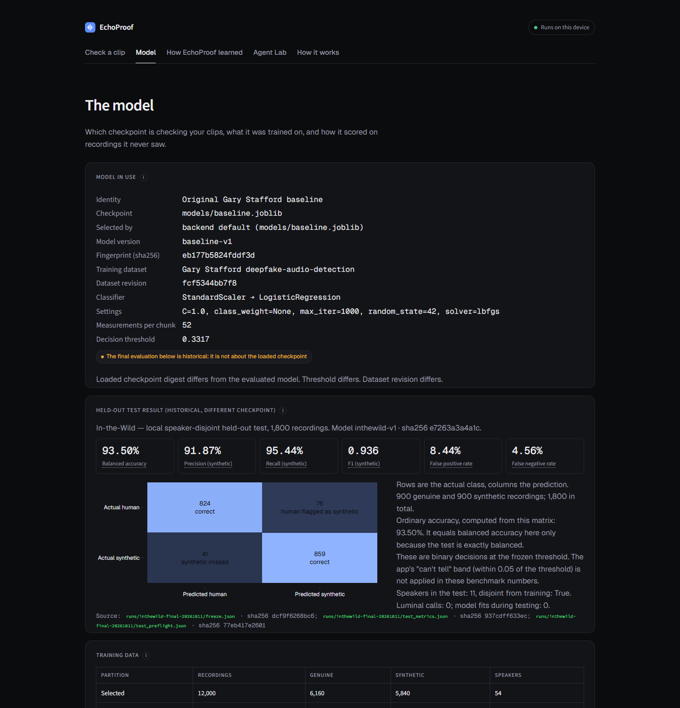
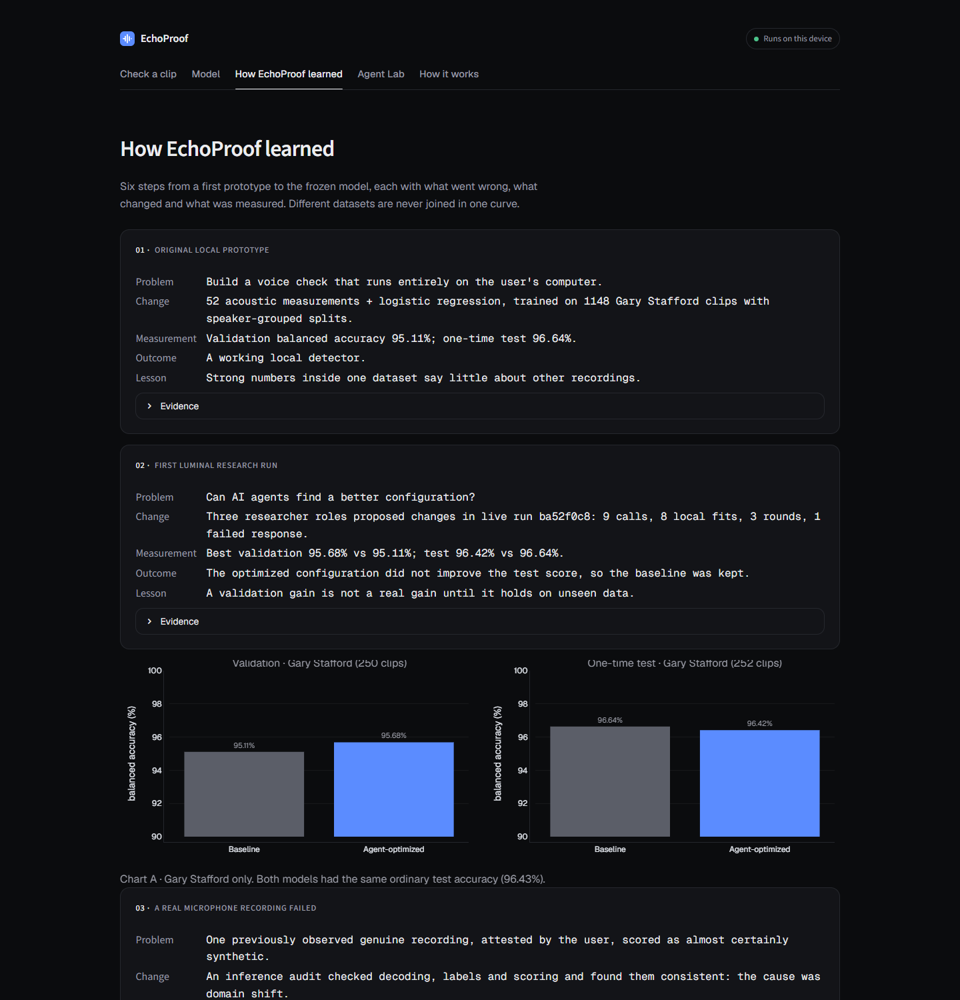
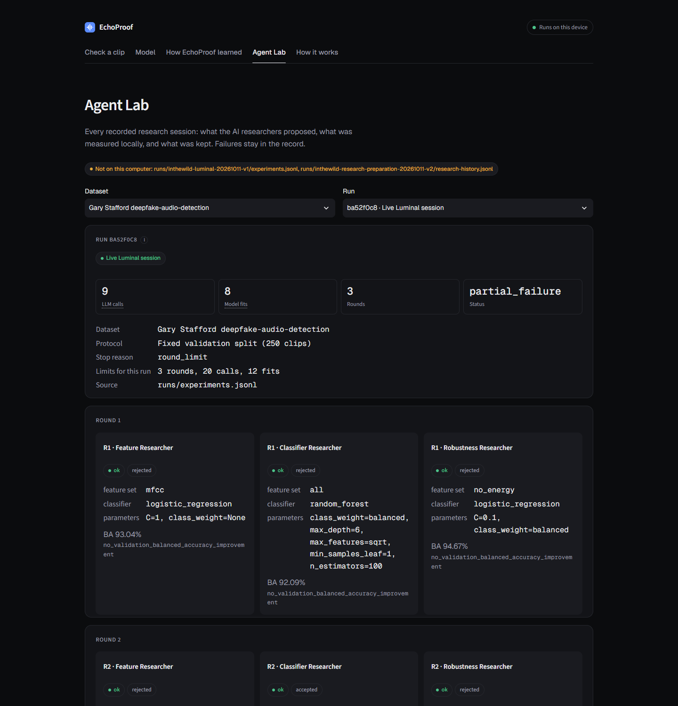

# EchoProof

**Check a voice clip before you act on it.**

Voice cloning now needs only a few seconds of someone's audio, and "family emergency" calls with a cloned voice are a known scam. EchoProof lets anyone drop in a voice note or call recording and get a plain answer in seconds: does it sound closer to a real human voice or to AI-generated speech, *why*, and what to do next.

Everything runs on your own computer. The audio is never uploaded.

> EchoProof is a research prototype built for a hackathon. Its score is a signal, not proof. See [Limitations](#limitations).



<sub>Screenshot: a clip spoken by the Windows built-in text-to-speech voice, scored by the committed baseline model (score 0.997, threshold 0.332). A real model output, not a mock.</sub>

## What it does

- **Plain answer.** "This clip sounds closer to AI-generated speech", "...closer to a real human voice", or "We can't tell from this clip".
- **Score with context.** A meter from human-like to AI-like, the model's decision threshold, and the "can't tell" zone around it.
- **Why.** The measurements that moved the score most (for example loudness changes or voice tone), read directly from the model's weights.
- **Clip-quality warnings.** Very short clips, lots of silence or distorted audio are flagged as harder to judge.
- **What to do next.** Verification steps based on FTC guidance (call back on a known number, use a family code word, treat payment requests as the warning sign), plus where to report fraud.
- **Upload or record.** WAV, MP3, M4A, FLAC or OGG up to 25 MiB and 120 seconds, or record straight from the microphone.
- **Save report.** A downloadable Markdown summary of the check.
- **Model transparency.** Pages showing which checkpoint is running (with its SHA-256 fingerprint), how it was evaluated, and every AI-agent experiment used to try to improve it.

| Chunk scores, waveform and spectrogram | The model in use and its held-out test |
|---|---|
|  |  |
| **How EchoProof learned** | **Agent Lab** |
|  |  |

## Quick start

Requires **Python 3.11** (3.12 also works for the app).

```bash
git clone https://github.com/ALatif11/Project-Spectra.git
cd Project-Spectra
python -m venv .venv
```

Activate the environment (`source .venv/bin/activate` on macOS/Linux, `.venv\Scripts\Activate.ps1` in Windows PowerShell), then:

```bash
python -m pip install -r requirements.txt
python -m streamlit run app.py
```

Open the URL Streamlit prints (usually http://localhost:8501). The trained checkpoints ship in `models/`, so the app works straight after cloning. If a checkpoint is missing, the app still opens and says the detector is unavailable.

To use a different checkpoint, set `ECHOPROOF_MODEL_PATH` to its path before starting Streamlit. `.joblib` files are Python pickles: only load ones from people you trust.

### Retrain from scratch (optional)

```bash
python -m scripts.download_dataset   # about 570 MB
python -m scripts.prepare_dataset --seed 42
python -m scripts.train_model
```

Details: [src/README.md](src/README.md).

### In-the-Wild demo model

The newer model, retrained on the In-the-Wild dataset, launches through a script that checks the frozen checkpoint's fingerprint first:

```bash
python -m scripts.launch_final_demo
python -m scripts.launch_final_demo --rollback   # back to the preserved baseline
```

It reads the freeze record in `runs/inthewild-final-20261011/freeze.json`. That record currently stores absolute paths from the machine that produced it, so on other computers the script stops rather than guess. Use `ECHOPROOF_MODEL_PATH=models/inthewild-final-frozen.joblib` instead.

## How it works

1. **Decode locally.** The file is decoded in memory and converted to 16 kHz mono (`src/audio.py`). M4A/AAC is first converted to WAV on your machine (`ui/convert.py`).
2. **Four-second chunks.** Each chunk gets 52 acoustic measurements: MFCC averages and variation plus brightness, bandwidth, rolloff, flatness, zero-crossing rate and loudness (`src/features.py`).
3. **Score.** A scaler and logistic-regression classifier score each chunk; the clip score is the duration-weighted average. Scores within 0.05 of the threshold are reported as "can't tell" (`src/inference.py`).
4. **Explain.** The "Why" list comes from the loaded model's own weights for this clip (`ui/explain.py`). It hides itself for model types that don't expose weights.

### AI agents (Luminal)

Three agents (feature, classifier and robustness roles) propose model changes through Luminal's OpenAI-compatible API. Deterministic Python trains and measures every proposal locally and keeps it only if it beats the current best on validation data. The agents see summary metrics only, never audio. Budgets are hard-capped in code. Every proposal, failure and metric is logged to `runs/experiments.jsonl` and replayed in the Agent Lab.

```bash
python -m pip install -r agents/requirements.txt
cp .env.example .env         # add your LUMINAL_API_KEY; .env is git-ignored
python -m scripts.test_luminal
python -m agents --dry-run   # offline, static proposals, real local fits
python -m agents             # live Luminal run
```

Details: [agents/README.md](agents/README.md) and [agents/research.md](agents/research.md).

## Results

**Original dataset.** [Gary Stafford deepfake audio dataset](https://huggingface.co/datasets/garystafford/deepfake-audio-detection), speaker-grouped splits, reports in `runs/`:

| Model | Validation balanced accuracy | Final test balanced accuracy (evaluated once) |
|---|---|---|
| Baseline | 95.11% | 96.64% |
| Agent-optimized (Luminal run `ba52f0c8`) | 95.68% | 96.42% |

The agents' pick improved validation but **not** the final test, so the baseline stayed the default. Write-up: [src/deployment.md](src/deployment.md).

**In-the-Wild.** [In-the-Wild](https://huggingface.co/datasets/SpeechAntiSpoofingBenchmarks/InTheWild), speaker-disjoint local partitions:

| Model | Validation balanced accuracy (1,800 clips) | Final test balanced accuracy (1,800 clips, 11 unseen speakers) |
|---|---|---|
| Original baseline | 46.45% | — |
| Retrained on In-the-Wild | 92.92% | 93.50% |

The original model is no better than chance on this data: a domain shift, not a bug. The gain comes from new training data, not from the agents. Reports: `runs/inthewild-final-20261011/` plus a sanitized summary of the preparation, comparison and verification reports in `ui/assets/project_evidence.json`. Workflow: [src/inthewild_experiment.md](src/inthewild_experiment.md).

## Limitations

- **Scores are uncalibrated.** A model score is not a probability, not a confidence level and not forensic proof.
- **Domain shift.** Training data is narrow. Genuine speech recorded on unfamiliar microphones, in echoey rooms, in other languages or with long pauses can score as AI-like. A real microphone recording scored 0.999 on the original baseline.
- **Unseen generators.** New voice-cloning tools the model has never heard may score as human-like.
- **Always verify another way.** EchoProof is one signal. Call the person back on a number you already know before sending money or information.

## Privacy

Audio is processed in memory on the local machine and never uploaded (the page loads its fonts from Google Fonts). Microphone recordings go only to the app running on this computer. The optional Luminal agents send only aggregate metrics and allow-listed settings, never audio, file names or per-clip scores.

## Project layout

| Path | What |
|---|---|
| `app.py`, `ui/` | Streamlit app: check-a-clip flow, explanations, model and evidence pages |
| `src/` | Decoding, features, training, evaluation, local inference (`predict_audio`) |
| `agents/` | Luminal client, constrained proposals, experiment runner |
| `scripts/` | Command-line entry points for data, training, evaluation and demo launch |
| `models/` | Committed checkpoints |
| `runs/` | Experiment history and evaluation reports |
| `tests/` | pytest suite |
| `data/` | Local datasets and caches (git-ignored) |

## Tests

```bash
python -m pytest -q
```

Known failures on Windows, all in backend tests: an agent test exceeds the Windows environment-variable size limit, In-the-Wild feature extraction imports the Unix-only `resource` module, and the In-the-Wild final tests read the absolute paths in `freeze.json`.

## Data and credits

- Gary Stafford, [Deepfake Audio Detection Dataset (v4)](https://huggingface.co/datasets/garystafford/deepfake-audio-detection), CC BY 4.0.
- [In-the-Wild](https://huggingface.co/datasets/SpeechAntiSpoofingBenchmarks/InTheWild) (Apache-2.0 redistribution). Müller et al., *Does Audio Deepfake Detection Generalize?*, Interspeech 2022.
- Scam guidance: [FTC consumer alert on AI voice cloning](https://consumer.ftc.gov/node/80688). Report fraud at [ReportFraud.ftc.gov](https://reportfraud.ftc.gov/).
